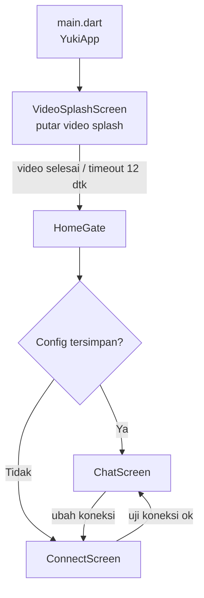
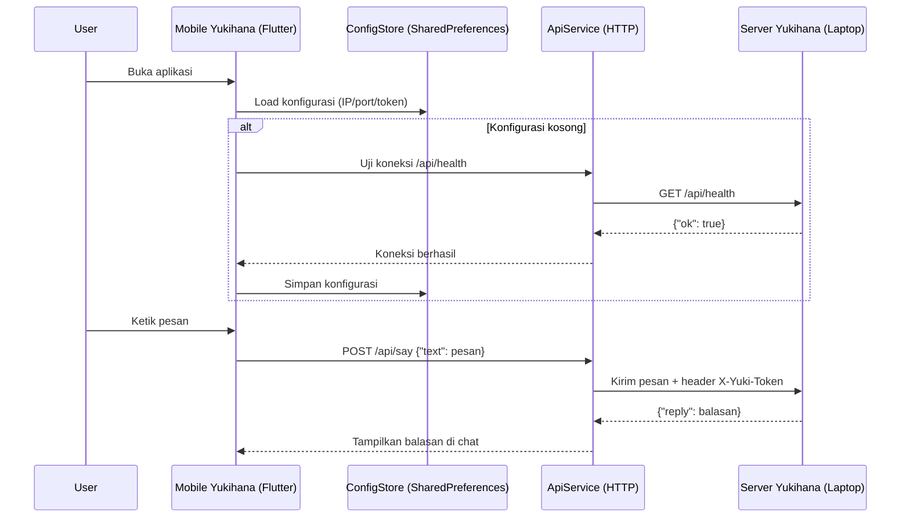

# 🌸 Mobile Yukihana

Aplikasi mobile **Flutter** untuk ngobrol (chat) dengan **Yukihana**, asisten pribadi yang berjalan di laptop/server di jaringan lokal (LAN). Ponsel dan laptop terhubung langsung lewat Wi-Fi yang sama menggunakan protokol HTTP sederhana.

> Ini adalah sisi *client mobile*. Asisten / server Yukihana berada di laptop dan menerima perintah lewat API.

---

## ✨ Fitur Utama

- 🎬 **Splash video** — animasi pembuka menggunakan `assets/Yukihana.mp4`, otomatis lanjut ke halaman utama setelah video selesai (atau maksimal 12 detik).
- 🔌 **Form koneksi** — isi IP laptop, port, dan token opsional, lalu uji koneksi sebelum menyimpan.
- 💬 **Chat real-time** — kirim pesan, Yukihana membalas dari laptop. Ada indikator "sedang mengetik".
- 🧠 **Konfigurasi tersimpan** — IP, port, dan token disimpan lokal lewat `SharedPreferences`, jadi tidak perlu diisi ulang setiap kali.
- 🎨 **Tema lavender** — desain Material 3 dengan font Poppins, gradien lembut, dan dekorasi kelopak/snowflake.

---

## 📁 Struktur Project

```text
mobileYuki/
├── lib/
│   ├── main.dart                     # Titik masuk aplikasi (entry point)
│   ├── screens/
│   │   ├── splash_screen.dart        # Splash video Yukihana
│   │   ├── home_gate.dart            # Gerbang: pilih halaman awal
│   │   ├── connect_screen.dart       # Form koneksi ke server
│   │   └── chat_screen.dart          # Layar utama chat dengan Yukihana
│   ├── services/
│   │   ├── api_service.dart          # Klien HTTP ke server Yukihana
│   │   └── config_store.dart         # Simpan/baca konfigurasi lokal
│   ├── theme/
│   │   └── app_theme.dart            # Design token & tema global
│   └── widgets/
│       └── app_background.dart       # Latar belakang bersama (gradien)
├── assets/
│   ├── Yukihana.mp4                  # Video splash
│   ├── Yukihana.png                  # Logo
│   ├── splash/logo.png               # Logo untuk native splash
│   └── ...
├── android/                          # Proyek Android
├── ios/                              # Proyek iOS
├── pubspec.yaml                      # Dependensi & aset
└── README.md
```

### Diagram Alur Aplikasi



### Diagram Arsitektur (Client–Server)



---

## ⚙️ Cara Kerja Aplikasi

1. **Splash** — Aplikasi dibuka, menampilkan video `assets/Yukihana.mp4`. Setelah video habis (atau jika gagal/melebihi 12 detik), otomatis berpindah ke `HomeGate`.
2. **Gerbang masuk** — `HomeGate` membaca konfigurasi yang tersimpan di ponsel (`ConfigStore`):
   - Jika **sudah ada** IP & port → langsung masuk ke `ChatScreen`.
   - Jika **belum ada** → arahkan ke `ConnectScreen`.
3. **Koneksi** — Di `ConnectScreen`, pengguna mengisi:
   - **IP laptop** (contoh `192.168.1.8`)
   - **Port** (contoh `8123`)
   - **Token** (opsional)
   - Tombol *Uji Koneksi* memanggil `GET /api/health` untuk memastikan server Yukihana aktif. Tombol *Simpan & Mulai Ngobrol* hanya menyimpan jika uji berhasil.
4. **Chat** — Di `ChatScreen`, setiap pesan dikirim ke `POST /api/say`. Server memproses teks (perintah/obrolan), lalu mengembalikan balasan `{"reply": "..."}` yang ditampilkan sebagai bubble chat. Ada status *"Yukihana sedang mengetik..."* selama menunggu respons.
5. **Simpan & ubah koneksi** — Konfigurasi disimpan di `SharedPreferences`. Dari `ChatScreen`, pengguna bisa mengubah koneksi lewat ikon info/setting kapan saja.

### Endpoint API yang Dipakai

| Method | Endpoint      | Fungsi                                  |
|--------|---------------|-----------------------------------------|
| GET    | `/api/health` | Cek apakah server Yukihana aktif        |
| POST   | `/api/say`    | Kirim pesan, terima balasan dari asisten |

---

## 🚀 Menjalankan Project

Pastikan Flutter SDK sudah terpasang, lalu jalankan:

```bash
flutter pub get
flutter run
```

> Aplikasi dan laptop harus berada dalam **jaringan yang sama** (Wi-Fi lokal). Untuk perangkat Android fisik, aktifkan debug USB atau pakai build APK, lalu isi IP laptop di form koneksi.

### Build APK

```bash
flutter build apk --release
```

---

## 🧰 Teknologi

| Teknologi        | Keterangan                                |
|------------------|-------------------------------------------|
| Flutter / Dart   | Framework UI                              |
| Material 3       | Desain modern + theming                   |
| `http`           | Klien HTTP untuk komunikasi ke server     |
| `shared_preferences` | Penyimpanan konfigurasi lokal         |
| `video_player`   | Pemutar video splash                      |
| `google_fonts`   | Font Poppins                              |
| `flutter_native_splash` | Splash bawaan saat aplikasi lahir |

---

Dibuat dengan 💜 untuk **Yukihana**.
